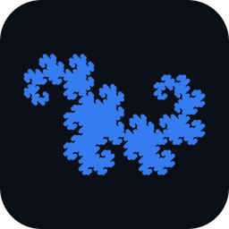

<div align="center">



# Voice Pen Plotter

**Speak, type or drop in a picture — and a GRBL pen plotter draws it.**

[](https://github.com/reis0x01/pen_plotter/actions/workflows/build.yml)


</div>

Voice Pen Plotter is a desktop application that drives a GRBL pen plotter from a single window.
It turns **speech** (English, Turkish and more), **typed text**, **photos and drawings** and
**PDF vector art** into clean pen strokes, checks every move against the paper and the machine
before anything moves, and streams the job safely to the controller. It replaces a separate GRBL
sender: connection, homing, jogging, settings, preview, plotting and the serial log are built in.

---

## Features

- **Voice to handwriting** — dictate with Google speech recognition (no account or API key),
  edit the transcript, and plot it in a single-stroke font. Turkish letters (ç ğ ı İ ö ş ü) are
  fully supported, plus hands-free voice commands ("new line", "pause", "resume", "stop").
- **Pictures to pen drawings** — photos, scans, sketches, logos and technical drawings are
  cleaned up and traced with OpenCV: remove colours with a click, crop, smooth noise, adjust
  tone, and choose centre lines, outlines, edges and cross-hatched shading.
- **Logical drawing order** — outlines first, then shading from light to dark; touching lines
  are joined into continuous strokes and the order is optimised (nearest neighbour + 2-opt) so
  the pen finishes one area before moving on. Replay the order before plotting.
- **Choose where it goes** — place drawings in any area of the sheet with presets, exact
  millimetres, or by dragging a rectangle on the live preview.
- **PDF vector drawings** — lines, curves and shapes from any PDF, fitted to the drawing area.
- **Safety first** — homing interlock, strict pen-up/pen-down discipline, and an independent
  validator that refuses (never clamps) any move outside the paper or the machine travel —
  checked before streaming *and* line by line while streaming.
- **Complete machine control** — connect, home, jog, set the paper origin, read and edit GRBL
  settings with explanations, pause/resume/stop, live position and progress with time estimate.
- **Simulation mode** — a built-in simulated GRBL (0.9 and 1.1) to rehearse every job without
  hardware.

| Picture to drawing | Plotting a traced picture |
|---|---|
|  |  |

| PDF vector drawing | GRBL settings with explanations |
|---|---|
|  |  |

---

## Download and install

Ready-made installers are attached to every
[**Release**](https://github.com/reis0x01/pen_plotter/releases/latest). They contain Python and every library
— nothing else has to be installed.

| System | File | How |
|---|---|---|
| **Windows 10 / 11** (64-bit) | `VoicePenPlotter-Setup-1.0.exe` | Run it, click **Next**, then start *Voice Pen Plotter* from the Start menu or desktop. |
| **Linux** (x86-64) | `VoicePenPlotter-1.0-linux-x86_64.tar.gz` | Unpack, run `VoicePenPlotter/install.sh` once for a menu entry, or start `VoicePenPlotter/VoicePenPlotter`. |

> **Windows SmartScreen** may say the publisher is unknown because the installer is not
> code-signed: choose **More info → Run anyway**. Arduino clones with a **CH340** USB chip may need
> that chip's driver before the COM port appears.
>
> **Linux:** allow access to the USB port with `sudo usermod -aG dialout $USER` (then log out and
> in), and install `libportaudio2` for microphone recording.

Speech recognition needs an internet connection; everything else works offline.

## Quick start

1. Start the app. On first launch it loads this plotter's confirmed machine profile.
2. To try it without hardware, tick **Simulation (no hardware)**. Otherwise choose the serial port.
3. Press **Connect**, then **⌂ Home**, then **Restore saved origin** (or **Set paper origin**).
4. Type or dictate text — or use **File → Open picture…** / **Open PDF drawing…**.
5. Check the preview, then press **▶ Plot**. **■ STOP** halts the machine at any time.

The [User Guide](docs/USER_GUIDE.md) covers every feature, the first hardware run and
calibration, and troubleshooting.

---

## Hardware

Built and tested on a 280 × 280 mm plotter:

| Part | Details |
|---|---|
| Controller | Arduino Uno + CNC Shield V3 (A4988 drivers) running **GRBL 0.9j** (1.1 also supported) |
| Motors | NEMA 17 on X, Y and Z |
| Pen lift | Z stepper (pen up Z+3, pen down Z−1 on this machine) |
| Homing | Limit switches on all axes, Z first, then X and Y |
| Paper | A4 portrait with a 10 mm safety margin |

The firmware is used as it is — the app never modifies, rebuilds or flashes it. Every
machine-specific value lives in an editable profile, so other GRBL plotters work too.

## Documentation

| Document | Contents |
|---|---|
| [User Guide](docs/USER_GUIDE.md) | Using the app, pictures, drawing area, PDF, voice, simulation, calibration, troubleshooting |
| [Development](docs/DEVELOPMENT.md) | Running from source, tests, building the installers, architecture, design decisions |
| [Project Guide](docs/PROJECT_GUIDE.md) | In-depth explanation of the whole system, module by module |
| [Hardware analysis](docs/ANALYSIS.md) | The original hardware and firmware analysis |

## Building from source

```bash
git clone git@github.com:reis0x01/pen_plotter.git
cd pen_plotter
./run.sh            # Windows: run.bat — creates a virtual environment and starts the app
```

Tests: `.venv/bin/python -m pytest` (201 tests, no hardware needed).
Installers: `packaging/build_windows.bat` on Windows, `packaging/build_linux.sh` on Linux — or
push a version tag and GitHub Actions builds both and publishes a Release.
Details are in [Development](docs/DEVELOPMENT.md).

## Built with

[PySide6 (Qt 6)](https://doc.qt.io/qtforpython-6/) ·
[OpenCV](https://opencv.org/) ·
[NumPy](https://numpy.org/) ·
[PyMuPDF](https://pymupdf.readthedocs.io/) ·
[pySerial](https://pyserial.readthedocs.io/) ·
[SpeechRecognition](https://github.com/Uberi/speech_recognition) ·
[sounddevice](https://python-sounddevice.readthedocs.io/) ·
[PyInstaller](https://pyinstaller.org/) ·
[Inno Setup](https://jrsoftware.org/isinfo.php) ·
Hershey single-stroke fonts

## License

Copyright © 2026 **MOHAMED OSSAMA ELIWA**. All rights reserved — see [LICENSE](LICENSE).
Third-party components keep their own licenses; see
[THIRD_PARTY_NOTICES.md](THIRD_PARTY_NOTICES.md).

## Author

**MOHAMED OSSAMA ELIWA**
