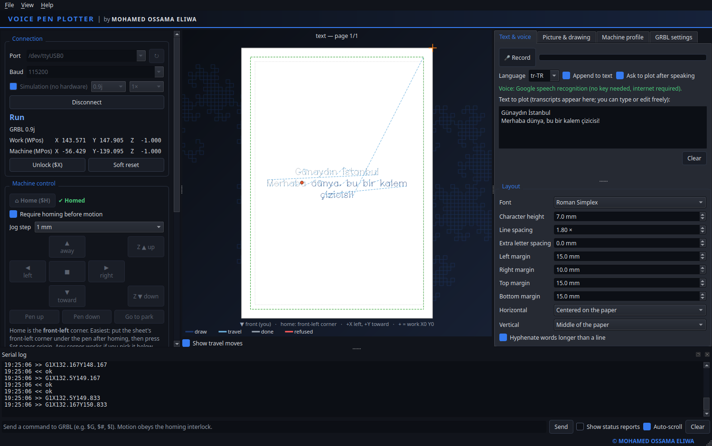
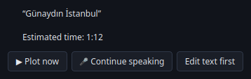
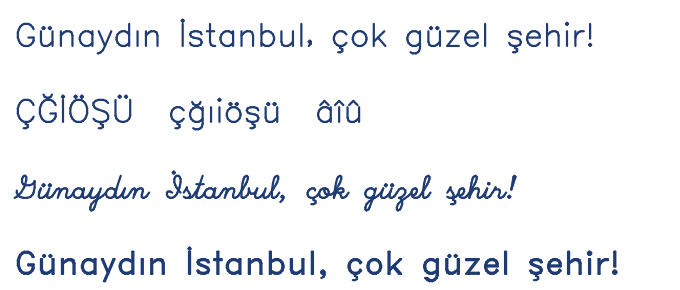
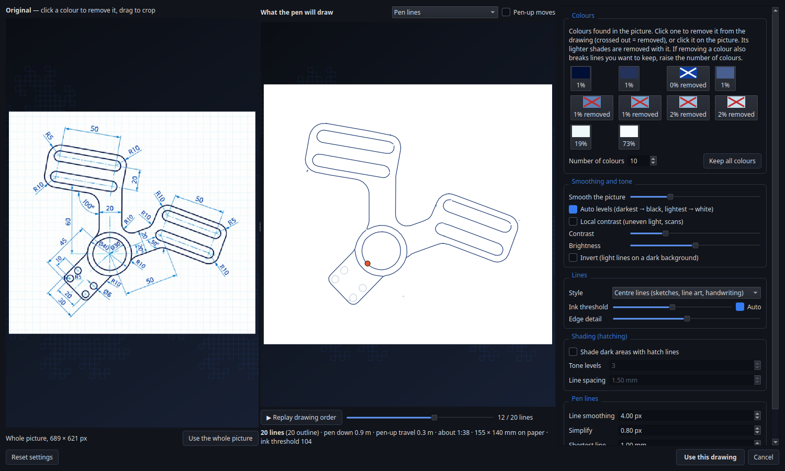
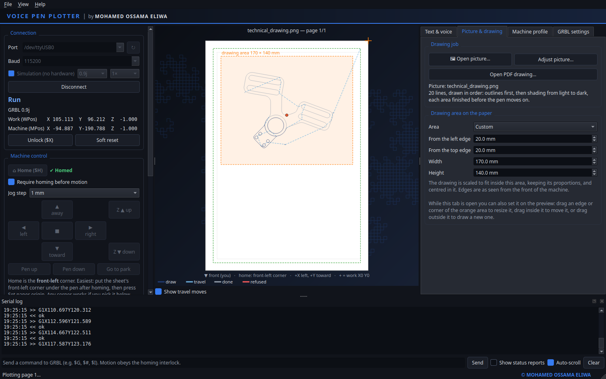
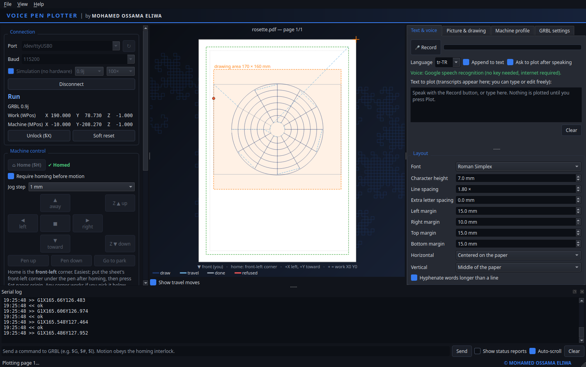
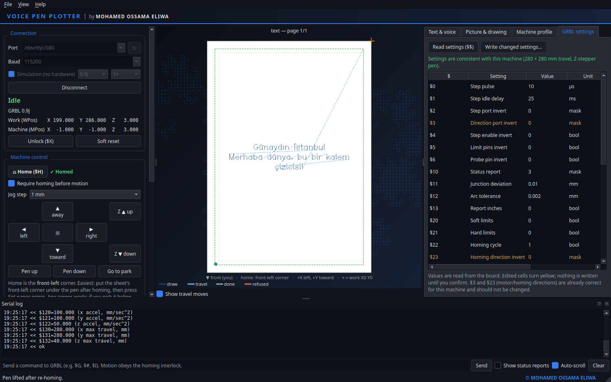

# User Guide

Everything about using Voice Pen Plotter, from the first connection to plotting pictures.

- [The window](#the-window)
- [Safety rules](#safety-rules)
- [Text and voice](#text-and-voice)
- [Pictures (photos, scans, sketches, logos)](#pictures)
- [Choosing where the drawing goes](#drawing-area)
- [PDF drawings](#pdf-drawings)
- [G-code files](#g-code-files)
- [Simulation mode](#simulation-mode)
- [Machine profile](#machine-profile)
- [First hardware run and calibration](#first-hardware-run-and-calibration)
- [Troubleshooting](#troubleshooting)

---

## The window

| Area | What's there |
|---|---|
| **Left** | *Connection* (port, baud, simulation, live state and positions, alarm explanations, Unlock / Soft reset), *Machine control* (Home, jog pad, pen up/down, park, set paper origin, set Z zero, center page) and *Plot* (page, **▶ Plot**, Pause, Resume, **■ STOP**, progress, remaining time). |
| **Centre** | The sheet as you see it from the front of the machine. Dark lines are pen-down strokes, dashed blue lines are pen-up travel, grey is already plotted, and red marks moves the safety check refused. The dot is the live pen (green = up, orange = down); the orange cross is work X0 Y0. |
| **Right tabs** | *Text & voice*, *Picture & drawing*, *Machine profile* and *GRBL settings*. |
| **Bottom** | The serial log of all traffic, with a command line for raw GRBL commands such as `$G`, `$#` or `$I`. |
| **Menus** | *File*: open a picture (Ctrl+I), PDF or G-code file, export G-code, calibration pattern, back to the text job, save profile. *Help → About*. |

## Safety rules

- **Homing interlock.** No motion (jog, pen, park, plot) until homing has succeeded in the current
  session. The override checkbox asks for confirmation and is never saved.
- **Pen discipline.** Every job raises the pen first, lifts it before every travel move, lowers it
  with a Z-only move before each stroke, and ends with the pen up and parked.
- **Refuse, never clamp.** Every job — generated or imported — is validated against the sheet
  minus the safety margin and against the machine travel at the current work origin, before
  streaming *and again line by line while streaming*. A violating job is refused and the offending
  line is shown.
- **STOP** sends a feed hold, then a soft reset. The position is then untrusted, so re-homing is
  required (which raises the pen first).
- Any GRBL `error:` or `ALARM` during a job stops the stream and holds the machine.
- The voice command "stop" is a convenience, **not an emergency stop** — recognition takes
  seconds. Use the on-screen **■ STOP** button or the machine's power switch.

---

## Text and voice

Type in the text box on the *Text & voice* tab, or press **🎤 Record**, speak, and press it again.

- Speech recognition uses Google's service over HTTPS. **No account, API key or credentials are
  needed**, only an internet connection. Recordings are limited to 55 seconds.
- Choose the language in the tab (`tr-TR` for Turkish, `en-US` for English, …). Turkish letters
  ç ğ ı İ ö ş ü and â î û are plotted in all three fonts. Characters the fonts can't draw are
  plotted as `?` with a warning.
- Google doesn't add punctuation — add it in the text box before plotting.
- After each dictation the app asks **Plot this text?**: **▶ Plot now**, **🎤 Continue speaking**
  or **Edit text first**. Untick *Ask to plot after speaking* to turn this off. Nothing is ever
  plotted without one of these confirmations or the Plot button, and the safety rules still apply.

**Voice commands** (editable under *Machine profile → Voice commands*):

| Say | Effect |
|---|---|
| "new line" — anywhere in a dictation | Line break |
| "stop" — as the whole utterance | Same as the STOP button |
| "pause" / "resume" — as the whole utterance | Feed hold / resume |
| Turkish: "yeni satır", "dur", "duraklat", "devam et" | New line, stop, pause, resume |

Control commands only count as the *entire* utterance, so dictating "don't stop now" writes those
words.

**Layout options** (below the text): three single-stroke fonts, character height, line and letter
spacing, margins, horizontal and vertical alignment, and hyphenation of very long words. Text that
doesn't fit one sheet continues on more pages; after each page the app asks you to place a new
sheet in the same position.

---

## Pictures (photos, scans, sketches, logos)

**File → Open picture…** (Ctrl+I), or *Open picture…* on the *Picture & drawing* tab. PNG, JPEG,
BMP, TIFF and WebP are supported. The picture window shows the original on the left and, on the
right, exactly the lines the pen will draw, updated live as you change settings.

### Colours

The colours found in the picture are shown as swatches with their share of the picture. Click a
swatch — or click that colour on the picture — to remove it: it's treated as white paper and never
drawn (backgrounds, coloured fills, watermarks, dimension lines). Its lighter shades are removed
with it, and lines of kept colours that a removed line crossed are mended. Click again to bring a
colour back.

A picture drawn with several inks needs one click per ink. Example: a technical drawing with black
outlines, bold blue text and thin light-blue dimensions — remove the bold blue and the light blue,
and only the part is left (as in the screenshot). If removing a colour also breaks lines you want
to keep, raise *Number of colours* so the two separate.

### Crop, smoothing and tone

- **Crop:** drag a rectangle on the original to plot only that part.
- **Smooth the picture:** edge-preserving smoothing — removes noise, paper grain and JPEG blocks
  while keeping edges sharp.
- **Auto levels** stretches the tones; **Local contrast** helps with unevenly lit photos and
  scans; contrast, brightness and invert work as usual.

### Line styles

| Style | Best for | What it draws |
|---|---|---|
| **Centre lines** | Sketches, line art, handwriting, technical drawings | Every dark line once, along its middle, straight through crossings |
| **Outlines** | Logos, silhouettes | The outline of each dark shape |
| **Edges** | Photos | The outlines of objects, from the picture's own contrast |

*Ink threshold* (centre lines, outlines) and *Edge detail* (edges) control how much is drawn.

**Shading** fills dark areas with hatch lines: each darker tone level adds a crossing direction,
and neighbouring rows are linked into zig-zags so the pen stays down across an area. *Line
spacing* is in millimetres on the paper.

**Pen lines:** *Line smoothing* removes pixel stair-steps (long lines are straightened, small text
keeps its shape), *Simplify* merges nearly straight runs into single moves for smoother motion, and
*Shortest line* drops specks.

### Drawing order

The machine never draws in random order. Outlines come first, then shading from the lightest tone
to the darkest — the way you would draw by hand. Within each layer, touching lines are joined into
continuous strokes and the order is optimised so the pen finishes one area before moving on, with
little pen-up travel. Press **▶ Replay drawing order** to watch it. The window also shows the number
of lines, the drawing and travel length, and the estimated time.

**Use this drawing** makes the picture the current job; **Adjust picture…** reopens the window
with the same settings.

---

## Choosing where the drawing goes

On the *Picture & drawing* tab, **Drawing area on the paper** decides where pictures and PDF
drawings are placed. They are scaled to fit inside it, keeping their proportions, and centred in
it.

- **Presets:** inside the text margins (default), the whole printable area, a half, a quarter, or
  the centre at half size.
- **Numbers:** distance from the left and top edges of the paper (as seen from the front of the
  machine), width and height, in mm.
- **On the preview** (while the tab is open): drag an edge or corner of the orange area to resize
  it, drag inside it to move it, or drag outside it to draw a new one.

The area always stays inside the safety margin and is saved in the machine profile.

---

## PDF drawings

**File → Open PDF drawing…**, choose the page and the size:

- **Fit to the page (keep proportions)** — scaled to fill the drawing area (default).
- **Actual size from the PDF** — plotted at its real size; refused if it doesn't fit.

Every vector line, curve and shape is drawn. Curves are flattened into short segments and filled
shapes are drawn as outlines. Pictures embedded in a PDF are ignored — save them as image files and
use *Open picture…*. PDF text is ignored unless converted to outlines in the drawing program
(Inkscape: *Path → Object to Path*).

## G-code files

**File → Open G-code file…** runs any file through the same validator before it can be plotted.
Supported: G0/G1, G90/G91, G4, G17/G21/G54/G94 and spindle M-codes (ignored). Arcs, inches,
G28/G30/G53/G92/G10, other coordinate systems and `$` commands are refused — flatten arcs in your
CAM tool. **File → Export G-code…** saves the current job (one file per page).

## Simulation mode

Tick **Simulation (no hardware)** before connecting. A simulated GRBL (1.1h or 0.9j, 1× to 100×
speed) runs the complete pipeline — boot alarm, homing, jogging, work offsets, character-counted
streaming with a real 128-byte buffer, feed hold, soft reset and settings. Nothing is sent to any
port.

## Machine profile

All machine-specific settings, saved automatically as JSON:
`%APPDATA%\voice_plotter\profile.json` (Windows) or `~/.config/voice_plotter/profile.json`
(Linux). On first start the app copies this plotter's confirmed profile into place.

| Setting | Generic default | This plotter |
|---|---|---|
| Paper | A4 portrait 210 × 297 mm, 10 mm safety margin | same |
| Usable travel | 280 × 280 mm | same |
| Axis orientation | +X right, +Y away | **+X left, +Y toward you** (home = front-left) |
| Pen | Up Z0, down Z−4, Z feed 300 mm/min | **Up Z+3, down Z−1** |
| Paper origin | not set | machine X−200 Y−287 |
| Feeds | Draw 1000, travel 2000 mm/min | same |
| Layout | Roman Simplex, 7 mm, left/top | centred on the paper |
| Speech | en-US | **tr-TR**, English + Turkish voice commands |

---

## First hardware run and calibration

Do these in order, with a hand near the power switch the first time.

1. **Power up and home.** Connect (115200 baud). GRBL starts in ALARM — that's normal. Press
   **Home**: Z rises first, then X and Y home.
2. **Check the jog directions.** Set the jog step to 10 mm and press **▶ right** and **▲ away**. If
   the pen moves the other way, change *Machine profile → Axis orientation*. Never change the
   firmware direction settings for this.
3. **Set Z zero.** Right after homing, press **Set Z zero here**. Pen heights are relative to this.
4. **Test the pen height.** Over scrap paper, **Pen down** should just touch the paper; **Pen up**
   must clearly lift it. Adjust *Pen down Z* / *Pen up Z* in the profile. Keep pen up below the Z
   switch (about Z+4 at most on this machine).
5. **Set the paper origin.** Right after homing, place the sheet so its home-side corner is 10 mm
   outside the pen tip, choose that corner and *10 mm inside the corner*, then **Set paper
   origin**. Any corner works if you jog the pen to it. The app checks that the whole page fits
   before sending anything. **Restore saved origin** re-applies it later.
6. **Calibrate.** *File → Load calibration pattern*, plot, and measure both 100 mm lines. If a
   line measures `L` mm: new `$100` (or `$101`) = current × 100 / `L`. Enter it on the *GRBL
   settings* tab, re-home and check.
7. **Plot a short test word** such as "Hello".

---

## Troubleshooting

| Symptom / message | Meaning and fix |
|---|---|
| `ALARM` at connect | Normal after power-up. Press **Home**. |
| `ALARM: Hard limit` | A limit switch triggered while moving; position is lost. Soft reset, move clear, home. |
| `ALARM: Soft limit` | A move was outside the machine travel. Soft reset, home, check the origin and job size. |
| `ALARM: Abort during cycle` | Reset while moving (e.g. STOP). Home again. |
| `ALARM: Homing fail` | A switch was not found or stayed pressed. Check wiring, `$5`, `$27`. |
| `error: Alarm lock` | Command sent while in alarm. Home first. |
| "Refused by the safety check … outside the safe area" | Content goes beyond the sheet minus the margin. Reduce the size or margins, or fix the file. |
| "… outside the machine travel" | The page doesn't fit at the current origin. Set the paper origin or use *Center page in machine travel*. |
| "No GRBL banner received" | Wrong port or baud, or another program has the port open. |
| No COM port on Windows | Install the USB-serial driver (CH340 for most Arduino clones). |
| Voice: "Cannot reach Google speech recognition" | You're offline or the request was blocked. Check the network, or type the text. |
| Voice: "No speech was recognised" | Speak closer to the microphone and watch the level meter. |
| Text mirrored or jogs go the wrong way | Fix *Axis orientation*: mirrored left-right → flip +X; upside-down → flip +Y; rotated 180° → both. |
| Pen doesn't lift / lines between letters | Pen-up height too low. Raise *Pen up Z*. |
| Picture: a web of lines over a photo | *Centre lines* is for line drawings. Use *Edges* (with shading) for photos, *Outlines* for logos. |
| Picture: background or a colour is drawn | Remove that colour (click its swatch), or raise *Brightness* / lower the *Ink threshold*. |
| Picture: removing a colour breaks lines you want | Raise *Number of colours* so they separate. |
| Picture: plot would take very long | Raise *Smooth the picture* and *Shortest line*, lower *Edge detail*, widen the hatch spacing, use fewer tone levels. |
| PDF: "No vector drawing found" | Scanned or photo PDF — export the page as PNG and use *Open picture…*. |
| Letters too big or small by a constant factor | Calibrate steps/mm (step 6 above). |
